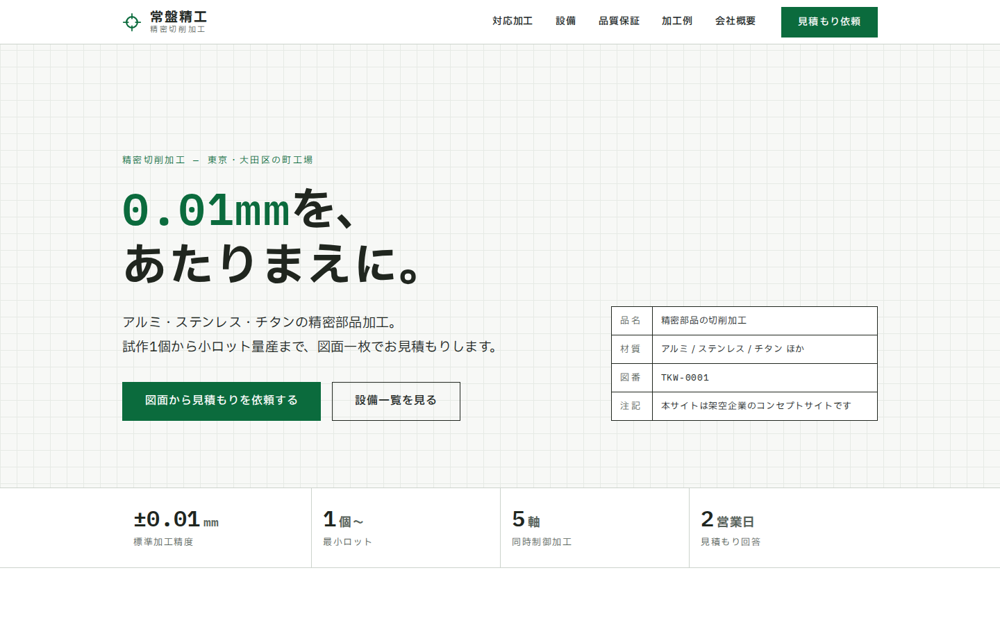

# 常盤精工株式会社(ときわせいこう)

> **Concept Project** — 本サイトはフロントエンド制作の実績提示を目的とした架空企業のコンセプトサイトです。「常盤精工株式会社」は実在せず、掲載している住所・電話番号・設備・加工例はすべて架空の設定です。フォームからの送信は行われません。

架空のB2B精密部品加工会社(町工場)のコーポレートサイト。
React + TypeScript + Vite による1ページ構成のレスポンシブサイトです。

姉妹作 [菓寮 月白](https://github.com/niwatory11/kario-tsukishiro)(世界観・情緒型の高級商材サイト)に対し、本作は**明快さ・信頼型のB2Bサイト**として設計軸を対比させた2作目です。



## デザインコンセプト

**「図面のように、話す。」**

B2B製造業の共通言語である機械図面の様式を、そのままデザイン言語にしています。

- **ファーストビューは図面一枚**: 方眼の机に白い図面用紙を置いた見立て。二重の図面枠と区域記号(A〜D / 1〜2)の中に、左は事業と精度の断定、右はフランジの正面図・断面図が製図の順序(中心線→外形→穴→ハッチング→寸法→精度の指示)で描かれ、架空企業である旨の注記は図面枠の右下の「表題欄」に収める
- **品質保証はページで唯一の墨の地**: 図面の指示寸法(φ48 H7・φ120・P.C.D. φ90・直角度0.01)を受ける「検査成績書(記入例)」を置き、行が埋まってから朱の検印を押す。測定値は例示で、実在の製品ではないと明記
- **見積もりの流れは工程図**: 工程の箱を矢印でつなぎ、各工程に「誰が」と「受け渡すもの」を書く。量産からは初品の工程へ戻る破線(リピートは同じ工程・検査基準で再現)
- **配色**: 白図面の紙色×墨×**常盤色**(社名と同源の伝統色。常緑=「変わらない品質」の宣言)。朱色は検印スタンプとフォームエラーのみ
- **タイポグラフィ**: IBM Plex Sans JP。寸法・型番・図番など数値はすべて IBM Plex Mono の等幅で組む
- **加工例は写真ではなく自作SVGの機械図面**(二面図・断面ハッチング・寸法線・公差)で提示
- **角丸ゼロ**(`--radius: 0`)。図面に角丸はない
- **モーションは「製図の手つき」**: 様式が現れる→罫線を引く→値を記入する、という製図の順序をリビール・SVG線画・罫線ドローの語彙で翻訳。フォームのエラーは「検図の指摘」として書き込まれ、ドロワーの開閉も同じ規律に従う(`prefers-reduced-motion` で全停止)
- 製造業サイトの定番(紺+オレンジ、工場写真、歯車アイコン)は意図的に不使用

## 主な機能

- 固定ヘッダー+右端に常設の見積もりCTA(B2Bの定石)
- モバイルドロワーナビゲーション(フォーカストラップ・Escapeで閉じる・背面スクロールロック)
- 設備一覧のスペック表・対応材質表(検証可能な具体で信頼を作る)
- **加工範囲の比較図**: 四台の加工機に載る大きさを、同じ縮尺で正面から描く。A4用紙を重ねて大きさの手がかりにする。各図の幅を「いちばん広い機械に対する割合」で決めるため、列幅が変わっても縮尺が揃う
- **加工方法の略図**: 対応加工の四項目に、図面と同じ線の使い分け(ワーク=墨の太線 / 工具=常盤色 / 中心線=一点鎖線)で描いた略図を添える。表示されたときに線を引く
- 見積もり依頼フォーム(フロントエンドバリデーション)
  - メール・電話形式、希望納期は「7日後〜180日後」の境界検証
  - blur時+送信時の検証、エラーサマリーからの各項目リンク、`aria-invalid` / `aria-describedby`
- スクロール連動ナビ(閲覧中セクションを `aria-current="location"` で表示)
- スキップリンク、セマンティックHTML、キーボード操作対応、`prefers-reduced-motion` 対応

## 技術構成

| 領域 | 採用技術 |
|---|---|
| フレームワーク | React 19 + TypeScript(strict) |
| ビルド | Vite 8 |
| スタイル | CSS Modules + CSS Custom Properties(デザイントークン) |
| フォント | @fontsource(セルフホスト・unicode-rangeスライス配信) |
| テスト | Vitest + Testing Library(56件) |
| lint | oxlint |

アニメーションライブラリ・CSSフレームワークは使用していません(依存は最小限)。

## セットアップ

```bash
npm install
npm run dev        # http://localhost:5173
```

## 開発コマンド

```bash
npm run lint       # oxlint
npm run typecheck  # tsc -b(TypeScript strict)
npm run test       # vitest(バリデーション・フォーム・ドロワー・スモーク)
npm run build      # 型チェック + production build(dist/)
npm run preview    # production buildの確認
```

## レスポンシブ対応

360 / 375 / 768 / 1024 / 1440px で表示確認済み(横スクロールなしを機械検査)。
設備表・図面SVG・フォームはモバイル向けに別レイアウトで設計しています。

## アクセシビリティ

- ランドマークと `aria-labelledby` によるセクション構造、h1〜h3の正しい階層
- スキップリンク、`:focus-visible` のフォーカスリング
- ドロワーのフォーカストラップとフォーカス返却
- 装飾SVGは `aria-hidden`、意味のある図面SVGは `role="img"` + 説明
- 本文コントラスト4.5:1以上、タップ領域44px以上
- `prefers-reduced-motion: reduce` でアニメーション・smooth scrollを無効化(duration と delay の両方を無効化。ナビの現在地表示は機能として維持)

## 設計根拠(市場調査ベース)

商業サイト12件の市場調査から抽出した設計原則(B2Bは情報階層と摩擦の少ない導線が信頼を生む/信頼は検証可能な具体で作る/業界クリシェを避ける、など)をもとに設計しています。原則と実装の対応は [docs/design-rationale.md](docs/design-rationale.md) を参照してください。

## デプロイ

`main` ブランチへのpushで、GitHub Actions(`.github/workflows/deploy.yml`)がlint・テスト・buildを実行し、GitHub Pagesへ自動デプロイします。

- ライブデモ: https://niwatory11.github.io/tokiwa-seiko/
- サブパス配信のため `vite.config.ts` で `base: '/tokiwa-seiko/'` を設定済み(リポジトリ名を変えた場合はここも変更)

他の静的ホスティング(Netlify / Vercel等)へは `npm run build` の `dist/` をそのまま配置できます(その場合 `base` を `'/'` に戻してください)。

## ライセンス・注意

個人ポートフォリオ用のコンセプト作品です。文章・SVG図面を含む全アセットは本リポジトリのために制作したものです。
